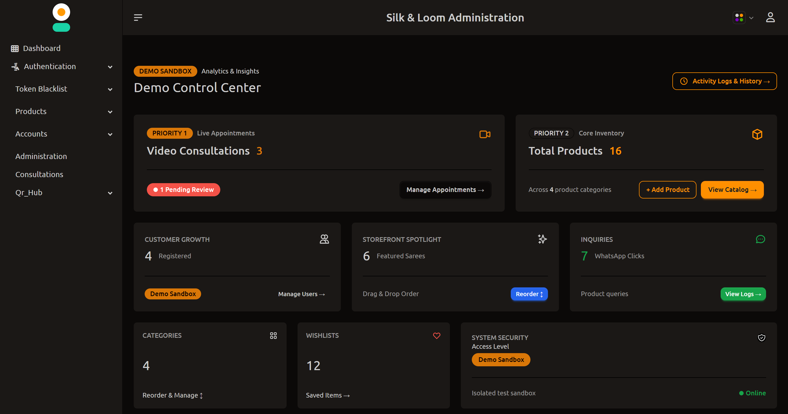
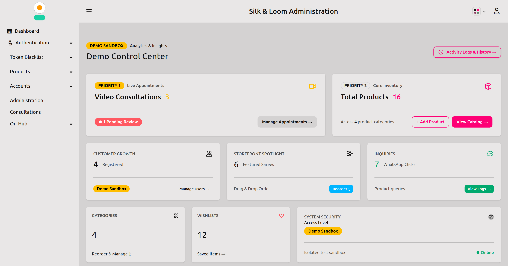
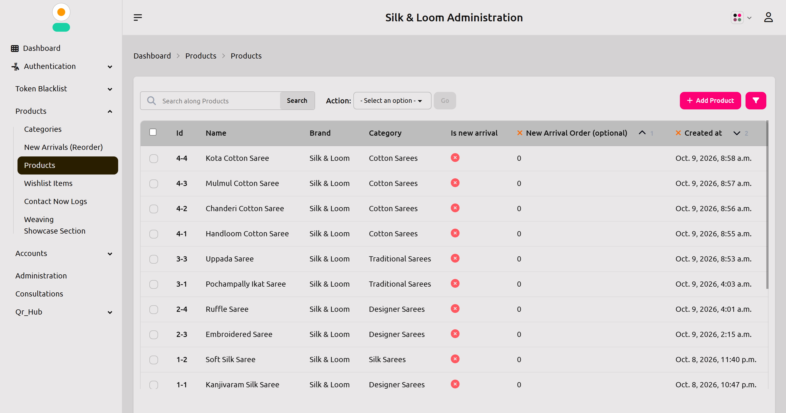
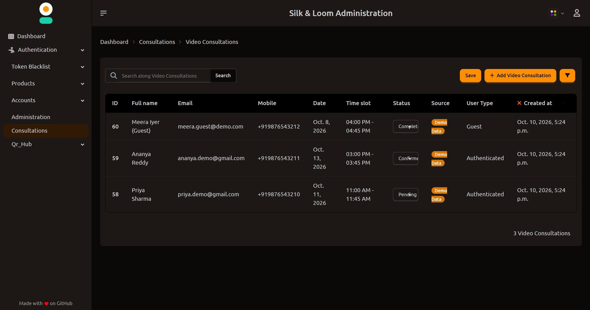

# 🥻 Saree Store Backend: Django REST API & Admin Engine

> A Django REST Framework backend with a custom Django Daisy admin dashboard for a handloom saree e-commerce store, featuring secure cookie-based JWT auth, OTP verification, live consultation booking, and a read-only demo sandbox.

[](https://www.python.org/)
[](https://www.djangoproject.com/)
[](https://www.django-rest-framework.org/)
[](https://www.postgresql.org/)
[](https://supabase.com/)
[](LICENSE)

---

## 📸 Screenshots

| Admin Dashboard (Dark) | Admin Dashboard (Light) |
| :---: | :---: |
|  |  |

| Product Management | Consultation Bookings |
| :---: | :---: |
|  |  |

---

## 🌐 Live Demo

> [!NOTE]
> The backend is hosted on Render's free tier, so the **first request may take 30-50 seconds** while the server wakes up.

- **API Base URL:** [https://saree-store-backend-ex17.onrender.com](https://saree-store-backend-ex17.onrender.com)
- **Admin Panel:** [https://saree-store-backend-ex17.onrender.com/admin/](https://saree-store-backend-ex17.onrender.com/admin/)
- **Frontend Repo:** [saree-store-frontend](https://github.com/s-akhil-08/saree-store-frontend.git)

**Demo admin login (read-only):**

| Role | Username | Password | Access |
| :--- | :--- | :--- | :--- |
| 🛡️ Demo Staff Admin | `demo_admin` | `DemoAdmin@123` | Dashboard and sandbox records, **no write access** |

All demo data is fictional and may be reset periodically.

---

## 🧰 Tech Stack

- **Backend:** Python, Django 5.1, Django REST Framework
- **Auth:** JWT in HTTP-only cookies, email OTP verification
- **Database:** PostgreSQL (Supabase)
- **Storage:** Supabase Storage (images auto-converted to WebP)
- **Admin UI:** Django Daisy (Tailwind + DaisyUI), django-adminsortable2
- **Deployment:** Render (Gunicorn)

---

## ✨ Features

- **Secure authentication:** passwordless-style OTP email verification (2-minute expiry), login with email or username, and IP/account-based rate limiting against brute force.
- **Catalog engine:** categories, products, colour variants with separate galleries, wishlists, and automatic WebP compression for uploads up to 50 MB.
- **Drag-and-drop merchandising:** reorder categories and new arrivals in the admin; changes reflect on the storefront immediately.
- **"Contact Now" WhatsApp inquiries:** no cart or checkout. Each inquiry is logged as a lead and the user is redirected to WhatsApp with product details pre-filled.
- **Video consultations:** book one-on-one shopping sessions (Google Meet / WhatsApp) as a guest or logged-in user, with confirmation emails.
- **QR Hub:** dynamic QR codes with UTM tags and scan analytics (IP, user agent, referer, device).
- **Bento-grid admin dashboard:** responsive, with dark/light themes and a paginated audit log.
- **Demo sandbox isolation:** a read-only demo admin that only sees demo data (see below).

---

## 🏛️ Architecture

```
ecommerce-django-rest-backend/
├── accounts/        # Auth, profiles, OTP, JWT cookies, user isolation
├── api/             # API routing and shared utilities
├── consultations/   # Video consultation booking and slots
├── products/        # Catalog, variants, galleries, wishlists, inquiries
├── qr_hub/          # QR codes and scan analytics
├── myproject/       # Settings, URLs, middleware, admin templates
├── .env.example
├── Procfile
├── build.sh
└── manage.py
```

---

## 🍪 Cookie-Based JWT Security

Tokens are stored in **HTTP-only cookies** instead of `localStorage`, so JavaScript cannot read them, which protects against token theft via XSS.

```python
response.set_cookie(
    key="access_token",
    value=tokens["access"],
    max_age=24 * 60 * 60,
    httponly=True,
    secure=not settings.DEBUG,
    samesite="None" if not settings.DEBUG else "Lax",  # cross-origin React frontend
    path="/",
)
```

Frontend requests must send credentials:

```javascript
const api = axios.create({
  baseURL: "https://your-backend-domain.com",
  withCredentials: true,
});
```

---

## 🧪 Master Admin vs Demo Sandbox

| Feature | Master Admin | Demo Admin |
| :--- | :--- | :--- |
| Data scope | Full production database | Isolated demo records only |
| Dashboard metrics | Real activity only | Demo numbers only |
| User directory | All users (demo accounts badged) | Only demo test accounts |
| Bookings and inquiries | Real records | Demo records only |
| Activity logs | Full audit log | Demo staff actions only |
| Real object IDs | Full access | Automatic 404 |
| Write access | Full read/write | **Read-only** when `DEMO_MODE=True` |

---

## 📊 Admin Dashboard Layout

```
+-----------------------------------------------------------------------------------+
|  Operations Dashboard                                         [ Activity Logs -> ] |
+-----------------------------------------------------------------------------------+
|  VIDEO CONSULTATIONS (7 cols)                  |  PRODUCT CATALOG (5 cols)        |
+------------------------------------------------+----------------------------------+
|  USER ACCOUNTS (4)  |  NEW ARRIVALS (4)  |  WHATSAPP INQUIRIES (4)                |
+---------------------+--------------------+----------------------------------------+
|  CATEGORIES (3)  |  WISHLISTS (3)  |  SYSTEM & DATA ISOLATION (6)                 |
+-----------------------------------------------------------------------------------+
```

---

<details>
<summary><b>🔌 API Reference (click to expand)</b></summary>

### Authentication (`/api/accounts/`)
| Method | Endpoint | Description | Auth |
| :--- | :--- | :--- | :--- |
| `POST` | `/register/` | Start registration, send OTP | No |
| `POST` | `/verify-otp/` | Verify OTP, issue JWT cookies | No |
| `POST` | `/login/` | Login with username or email | No |
| `POST` | `/logout/` | Clear session cookies | Yes |
| `GET` | `/me/` | Current user profile | Yes |
| `POST` | `/forgot-password/request/` | Request reset OTP | No |
| `POST` | `/forgot-password/reset/` | Verify OTP, set new password | No |
| `POST` | `/profile/request-update/` | Request profile-update OTP | Yes |
| `POST` | `/profile/verify-update/` | Apply profile update | Yes |

### Products (`/api/products/`)
| Method | Endpoint | Description | Auth |
| :--- | :--- | :--- | :--- |
| `GET` | `/categories/` | List categories | No |
| `GET` | `/` | List products (pagination, filters) | No |
| `GET` | `/<id>/` | Product detail with variants and gallery | No |
| `GET` | `/new-arrivals/` | Curated new arrivals | No |
| `GET` | `/wishlist/` | User wishlist | Yes |
| `POST` / `DELETE` | `/wishlist/<product_id>/` | Add / remove wishlist item | Yes |
| `POST` | `/contact/` | Log lead, return WhatsApp link | Optional |
| `POST` | `/reorder_new_arrivals/` | Update sort order | Admin |
| `POST` | `/api/categories/reorder/` | Reorder categories | Admin |

### Consultations (`/api/consultations/`)
| Method | Endpoint | Description | Auth |
| :--- | :--- | :--- | :--- |
| `POST` | `/book/` | Book a video consultation | Optional |
| `GET` | `/my-bookings/` | User's appointments | Yes |

### QR Hub (`/api/qr/`)
| Method | Endpoint | Description | Auth |
| :--- | :--- | :--- | :--- |
| `GET` | `/<slug>/` | Resolve QR code, log scan | No |
| `POST` | `/track-click/` | Track CTA click | No |

</details>

<details>
<summary><b>💬 "Contact Now" WhatsApp Flow (click to expand)</b></summary>

1. The frontend sends a `POST` to `/api/products/contact/`:
   ```json
   {
     "product_id": "1-1",
     "name": "Demo User",
     "mobile": "9999999999"
   }
   ```
2. The backend saves the lead in `ContactLog` and returns:
   ```json
   {
     "success": true,
     "whatsapp_number": "919999999999",
     "whatsapp_url": "https://web.whatsapp.com/send?phone=919999999999&text=...",
     "message": "Hello, I am interested in this product: ..."
   }
   ```
3. The frontend redirects:
   ```javascript
   window.open(response.data.whatsapp_url, "_blank");
   ```

To change the number, set `WHATSAPP_NUMBER` (country code, no `+` or spaces) in your environment and restart the server.

</details>

---

## ⚙️ Environment Variables

Copy `.env.example` to `.env` and fill in your values:

```env
# Core Django
SECRET_KEY=your-strong-random-secret-key
DEBUG=False
DEMO_MODE=True
ALLOWED_HOSTS=localhost,127.0.0.1,.vercel.app,.onrender.com

# PostgreSQL
DB_ENGINE=django.db.backends.postgresql
DB_NAME=postgres
DB_USER=your_db_user
DB_PASSWORD=your_secure_password
DB_HOST=your-db-host
DB_PORT=6543

# Supabase Storage
SUPABASE_URL=https://your-project.supabase.co
SUPABASE_KEY=your-supabase-service-key
SUPABASE_BUCKET=product-images

# Email (Gmail SMTP)
EMAIL_HOST=smtp.gmail.com
EMAIL_PORT=587
EMAIL_USE_TLS=True
EMAIL_HOST_USER=your-email@gmail.com
EMAIL_HOST_PASSWORD=your-google-app-password
DEFAULT_FROM_EMAIL=Saree Store Demo <your-email@gmail.com>

# Frontend integration
FRONTEND_URL=https://your-storefront.vercel.app
ADMIN_LOGIN_URL=https://your-storefront.vercel.app/admin/login
WHATSAPP_NUMBER=919999999999
```

> ⚠️ Never commit your real `.env` file.

---

## 🚀 Local Setup

```bash
# 1. Clone
git clone https://github.com/s-akhil-08/saree-store-backend.git
cd saree-store-backend

# 2. Virtual environment
python -m venv venv
source venv/bin/activate        # Windows: venv\Scripts\activate

# 3. Install dependencies
pip install -r requirements.txt

# 4. Configure environment
cp .env.example .env            # then edit .env

# 5. Database and demo data
python manage.py migrate
python manage.py setup_demo_accounts
python manage.py createsuperuser

# 6. Run
python manage.py collectstatic --noinput
python manage.py runserver
```

Open the admin at `http://127.0.0.1:8000/admin/`.

---

## 🚢 Deployment (Render)

1. Add the environment variables from `.env.example` in the Render dashboard.
2. **Build command:**
   ```bash
   pip install -r requirements.txt && python manage.py collectstatic --noinput && python manage.py migrate
   ```
3. **Start command:**
   ```bash
   gunicorn myproject.wsgi:application --bind 0.0.0.0:$PORT
   ```

---

<details>
<summary><b>🗑️ Disable or Remove Demo Features for Production</b></summary>

**Option A: Turn off demo mode (recommended).** Set `DEMO_MODE=False` in your production environment. This disables the read-only demo protection.

**Option B: Purge demo records.**
```bash
python manage.py shell -c "
from django.contrib.auth.models import User
from consultations.models import Consultation
from products.models import ContactLog

User.objects.filter(profile__is_demo=True).delete()
User.objects.filter(username__in=['demo_admin', 'demo_user', 'demo_priya', 'demo_ananya']).delete()
Consultation.objects.filter(is_demo=True).delete()
ContactLog.objects.filter(is_demo=True).delete()
print('Demo accounts and sandbox records purged.')
"
```

**Option C: Remove the demo code entirely.**
1. Remove `is_demo` fields from the `Profile`, `Consultation`, and `ContactLog` models.
2. Remove `myproject.middleware.ReadOnlyAdminMiddleware` from `MIDDLEWARE` in `settings.py`.
3. Run `python manage.py makemigrations && python manage.py migrate`.

</details>

---

## 💡 Design Decisions

- **HTTP-only cookies over localStorage** to keep tokens out of reach of XSS.
- **Data isolation at the queryset level** so the demo admin can never read real customer records, and real IDs return 404 rather than 403.
- **WhatsApp inquiries instead of checkout** to match how small handloom sellers actually close sales, while still capturing every lead.
- **Server-side image compression** (WebP) to keep pages fast on mobile networks without losing fabric texture.

---


## 📄 License

Licensed under the [MIT License](LICENSE).
